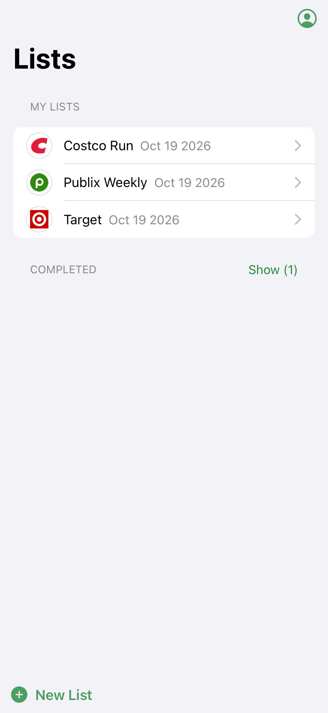
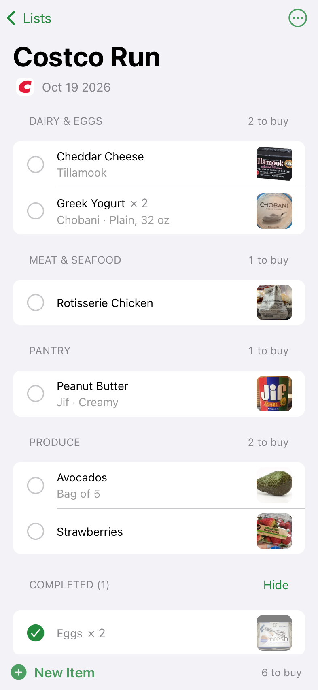
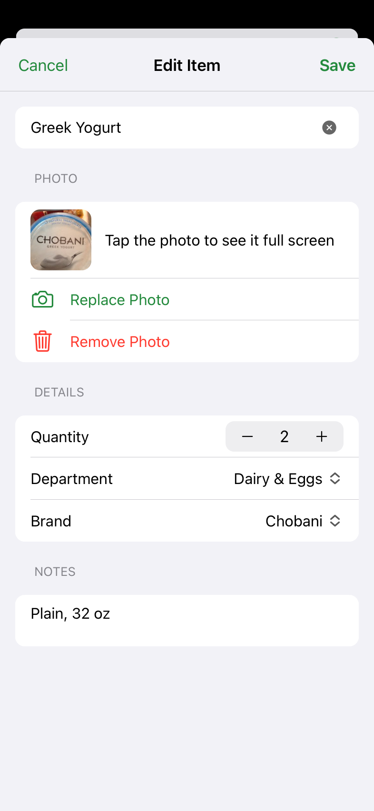
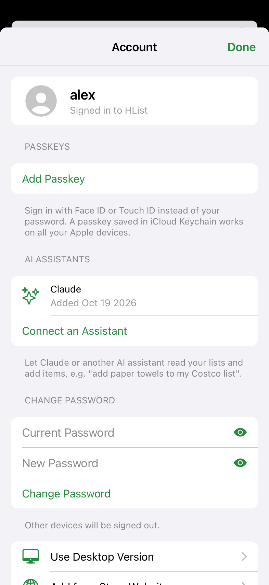
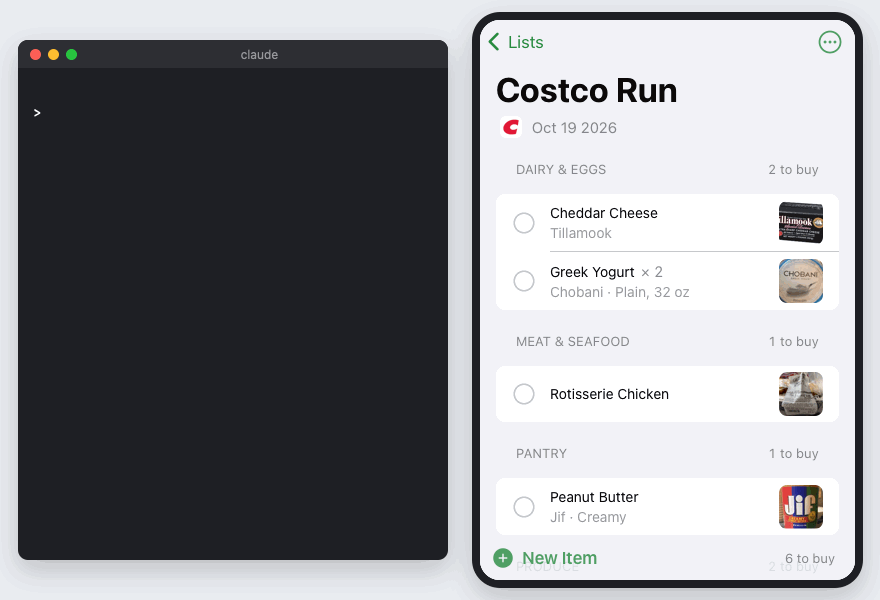

# HList

[](https://github.com/apbthere/hlist-server/actions/workflows/ci.yml)

A self-hosted shopping list app with a built-in **MCP server**, so Claude, ChatGPT, Grok or any other AI assistant can
read your lists and add items to them. Say "add paper towels to my Costco list" and the assistant finds the list,
checks what you've bought before, and adds the right product with its brand, department and photo.

This repository is the server. The iOS-style mobile client is
[hlist-client](https://github.com/apbthere/hlist-client).

<p align="center">
  
  
  
  
</p>

<p align="center">
  
  <br>
  <sub>The MCP calls an assistant makes for "add the usual oat milk to my Costco list"; the app updates live.</sub>
</p>

## Tech stack

| Area | Technologies |
| --- | --- |
| Server | Java 25, Spring Boot 4.1, Spring Data JDBC, Jackson 3, H2 |
| Security | Spring Security 7: form login, persistent remember-me, CSRF, **passkeys** (WebAuthn / Face ID) |
| AI integration | **Model Context Protocol** (Streamable HTTP, JSON-RPC), **OAuth 2.1** with PKCE and dynamic client registration |
| Real-time | Server-sent events: changes show up on every device right away |
| Mobile client | Vue 3, Ionic 9, TypeScript, Vite, installable PWA (no App Store) |
| Testing | JUnit 5 + MockMvc (100+ tests), Vitest, Playwright end-to-end tests |
| Delivery | Multi-stage Docker build, GitHub Actions CI, Caddy + Let's Encrypt on a home NAS |

## Architecture

```
 iPhone / iPad (PWA)     Desktop browser       Claude / ChatGPT
   Vue 3 + Ionic          plain HTML/JS          MCP client
        │                     │                      │
        │  /app/, /api   cookies + CSRF              │  /mcp  Bearer token (OAuth)
        └──────────┬──────────┘                      │
                   ▼                                 ▼
   ┌──────────────────────── Spring Boot ────────────────────────┐
   │  REST controllers   SSE /api/events   MCP + OAuth server     │
   │  Lists & items   Photos   Store detection   Passkeys         │
   │  SafeDownloader: the only way out to the internet            │
   └───────────────┬────────────────────────────┬─────────────────┘
                   ▼                            ▼
            H2 (file database)     Store sites, Open Food Facts
```

The client and API share one origin, so sign-in is a plain session cookie with no CORS.
[docs/architecture.md](docs/architecture.md) covers the request flow, the security model, live updates and the
SSRF policy; [docs/api.md](docs/api.md) lists every endpoint. A few things worth a look:

- **MCP server written from the spec** ([assistant/](src/main/java/com/abcconsulting/slme/server/assistant/)):
  no SDK, just a JSON-RPC controller, tool schemas and server instructions that teach the assistant a workflow
  (find the list, check for duplicates, prefer past purchases, then search the web).
- **OAuth 2.1 authorization server** for the MCP authorization spec: protected-resource and authorization-server
  metadata, dynamic client registration, PKCE (S256), consent page. Connecting from claude.ai or ChatGPT is
  paste-the-URL-and-sign-in.
- **Safe outbound fetching** ([web/](src/main/java/com/abcconsulting/slme/server/web/)): every fetch of a
  user- or AI-supplied URL is HTTPS only, resolves to public addresses only (re-checked on each redirect) and has
  size and time limits, which protects the server from SSRF.
- **Product photos**: from a product page's `og:image` or JSON-LD, or found on Open Food Facts by brand and name.
  Uploads are re-encoded as JPEG, which removes EXIF and GPS data.
- **Live updates**: services publish domain events that go out over SSE after the transaction commits; each device
  skips its own changes.

## AI assistant tools

| Tool | What it does |
| --- | --- |
| `list_shopping_lists` | Finds lists by store or name, newest first |
| `create_shopping_list` | Starts a new list |
| `get_list_items` | Reads a list |
| `search_item_history` | Searches everything you've bought before, optionally at one store |
| `add_item_to_list` | Adds a past item again, or a new one from a product page (photo included); never duplicates |
| `remove_item_from_list` | Removes an item |
| `set_item_photo` | Sets an item's photo from a product page or image |
| `list_departments` | The departments items are grouped by |

### Example interaction

> **You:** Add Bounty paper towels and the usual oat milk to my Costco list.
>
> **Claude:** *calls `list_shopping_lists` (search "costco"), `get_list_items`, `search_item_history` for each item*
>
> Added to **Costco, Oct 18**:
> - **Oat Milk** (Califia Farms, Dairy), the same one you bought last month, with its photo.
> - **Paper Towels** (Bounty, Paper Goods), new: I used the costco.com product page, so it has a product photo.

> **You:** What's still on my Publix list?
>
> **Claude:** 6 items left: Bananas, Greek Yogurt, Sourdough Bread… (Eggs and Coffee are already checked off.)

## Running it

You need Java 25, plus Node 24 to build the mobile client. Clone both repositories side by side.

```sh
# Mobile client
cd hlist-client && npm ci && npm run build && cd ..

# Server: http://localhost:8080 (desktop UI) and http://localhost:8080/app/ (mobile)
cd hlist-server && ./mvnw spring-boot:run
```

Or with Docker, which builds both into one image:

```sh
cd hlist-server && docker compose up --build
```

Settings (environment variables):

| Variable | Purpose |
| --- | --- |
| `H2_DB_PATH` | Database location (default `./data/server`) |
| `HLIST_INVITE_CODE` | If set, new accounts need this code |
| `HLIST_DOMAIN` | Your HTTPS domain, for passkeys |

For HTTPS on a home server, see [deploy/qnap/README.md](deploy/qnap/README.md) (Docker + Caddy + Let's Encrypt).

### Connecting an assistant

[docs/connecting-assistants.md](docs/connecting-assistants.md) walks through each assistant step by step, with
example requests and troubleshooting. In short:

- **claude.ai, the Claude apps, ChatGPT or Grok:** add a custom connector with the URL `https://<your-host>/mcp`,
  then sign in and click Allow.
- **Claude Code:** create an access token in the mobile app (Account → Connect an Assistant), then:

  ```sh
  claude mcp add --transport http hlist https://<your-host>/mcp --header "Authorization: Bearer <token>"
  ```

## Tests

```sh
./mvnw test                         # server
cd ../hlist-client && npm test      # client unit tests
npm run e2e                         # client end-to-end tests against a real server
```

## Contributing

See [CONTRIBUTING.md](CONTRIBUTING.md) for setup, tests and pull request conventions.

## License

[MIT](LICENSE)
