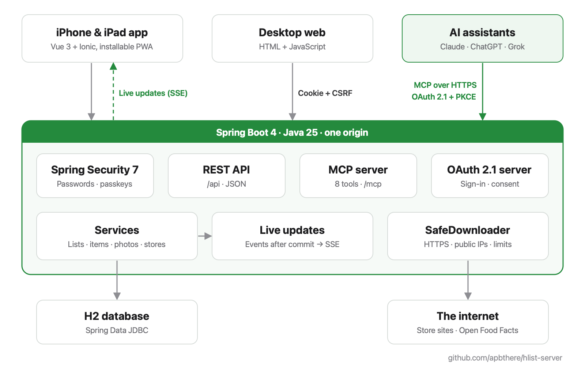

# Architecture

HList is one Spring Boot application with one H2 database. It serves three kinds of client from one origin:

- the mobile client (Vue + Ionic, from the [hlist-client](https://github.com/apbthere/hlist-client) repository)
  under `/app/`;
- the desktop pages (plain HTML/JS in `src/main/resources/static/`) at `/`;
- AI assistants, over the Model Context Protocol at `/mcp`.

The endpoints are listed in [api.md](api.md), and connecting each assistant is in
[connecting-assistants.md](connecting-assistants.md). The code is in `src/main/java/com/abcconsulting/slme/server/`;
package names below are relative to that.



```
 iPhone / iPad (PWA)     Desktop browser       Claude / ChatGPT
   /app/  (Vue)           /  (HTML/JS)          MCP client
        │                     │                      │
        └── session cookie + CSRF token ──┐          │  Bearer hlist_... token
                                          ▼          ▼
   ┌─────────────────────────── Spring Security ──────────────────────────┐
   │  form login · passkeys · remember-me · CSRF    AccessTokenFilter (/mcp)│
   └──────────────┬───────────────────────────────────────┬───────────────┘
                  ▼                                       ▼
   controller/  photos/  stores/  live/          assistant/McpController
                  │                                       │
                  └──────────────┬────────────────────────┘
                                 ▼
               service/ShoppingListService ── publishes DataChangedEvent
                                 │                          │ after commit
                                 ▼                          ▼
                      H2 (Spring Data JDBC)        live/LiveUpdateService ── SSE ──▶ open clients
```

## Request flow

1. **Security.** Every request goes through one of two Spring Security filter chains (`config/SecurityConfiguration`):
   - The OAuth chain covers `/oauth/token`, `/oauth/register` and the `/.well-known/` metadata. Assistants'
     servers call these directly, so the chain is stateless, with no CSRF protection and no Basic sign-in.
   - The main chain covers everything else. It signs the request in from the session, the remember-me cookie,
     Basic credentials or, on `/mcp` only, an access token.
2. **Controllers** in `controller/`, `photos/`, `stores/`, `live/` and `assistant/` take the signed-in username
   from `Authentication`. They never take a username from the request.
3. **Services** do the work. `ShoppingListService` checks that each list and item belongs to the username it is
   given. Lists, items and photos are private to their owner. Departments and brands are shared by all users.
4. **Repositories** (`repository/`) use Spring Data JDBC records in `model/`, plus `JdbcTemplate` where SQL is
   simpler. `schema.sql` runs on every start and is idempotent. There are no migrations.
5. **Errors** become JSON `{"message": "..."}` in `ApiExceptionHandler`:

   | Exception | Status |
   | --- | --- |
   | `IllegalArgumentException` | 400 |
   | `NoSuchElementException` | 404 |
   | `InUseException` | 409 |
   | `PhotoTooLargeException` | 413 |

   Clients show the message to the user as is.

The mobile client is static files from the client's `dist/` folder (`hlist.client.location`), served by
`config/ClientAppConfiguration`:

- Paths without a file extension, such as `/app/lists/12`, fall back to `index.html` for client-side routing.
- Hashed files in `/app/assets/` are cached for a year.

## Security model

There are two kinds of credential, and each works only where it is safe.

**Browsers: session cookie plus CSRF token.**

- Sign-in methods:
  - a password: `POST /api/auth/login`, a form post;
  - a passkey: Spring Security's WebAuthn endpoints, with user verification (Face ID, Touch ID or the device
    passcode) required, because a passkey replaces the password.
- Both sign-ins answer 204 or 401 with no redirects, start a new session ID and CSRF token, and can set a
  remember-me cookie that lasts 30 days.
- Remember-me tokens are stored in `persistent_logins` and change on each use. `RenewableRememberMeServices`
  locks each token series and accepts the token it just replaced for 60 seconds. Without that, parallel requests
  from a waking device would look like cookie theft.
- Changing the password signs out the other devices.
- CSRF uses `csrf.spa()`: the server sets an `XSRF-TOKEN` cookie, and pages send it back in an `X-XSRF-TOKEN`
  header on every unsafe request.
- Cookies are `SameSite=Lax`. Unauthenticated requests get a 401 with no `WWW-Authenticate` header, so browsers
  never show a Basic sign-in prompt.
- Basic sign-in stays enabled for curl and tests. Requests that carry an `Authorization` header skip the CSRF
  check, because browsers never add that header to cross-site requests on their own.

**AI assistants: Bearer access tokens, on `/mcp` only.**

- Tokens look like `hlist_` followed by 32 random bytes. They are shown once and stored as SHA-256 hashes in
  `access_token`, with at most 20 per user.
- `assistant/AccessTokenFilter` accepts a token only on `/mcp`, so a leaked token can't change the password,
  manage passkeys or create more tokens. The header can be `Bearer hlist_...` or just `hlist_...`, because some
  clients, such as the xAI API, don't say whether they add `Bearer `.
- `/mcp` accepts only token sign-ins and never a session cookie. A malicious page therefore can't use a signed-in
  browser to call it, and it needs no CSRF token.
- Tokens don't expire. Users remove them in the Account sheet, which shows when each was last used.
- **Getting a token, by hand:** create one in the Account sheet, or with `POST /api/users/me/access-tokens`.
- **Getting a token, by OAuth 2.1** (`assistant/OAuthService`), the MCP authorization spec as used by claude.ai
  and ChatGPT:
  1. A 401 from `/mcp` names the protected-resource metadata (RFC 9728).
  2. The client registers itself (RFC 7591). Redirect URIs must be HTTPS, or `http://localhost`. Registrations
     that never got a token are cleared once there are 500.
  3. The user signs in and approves the client on `authorize.html`.
  4. The client exchanges the one-time code at `/oauth/token`. PKCE with S256 is required; codes last 5 minutes,
     and pending approvals 15.
  5. The resulting token is an ordinary access token named after the client. Reconnecting replaces it.
  Pending approvals and codes are kept in memory, so after a restart the user just connects again.

**Registration** is open unless `HLIST_INVITE_CODE` is set (`service/RegistrationPolicy`). Usernames are
case-insensitive.

**Public endpoints** are limited to these:

- what the sign-in and sign-up pages need;
- the build version;
- the store list and store icons, which hold nothing about any user;
- the static pages and the mobile client's files;
- the OAuth endpoints.

## Live updates

Every open client keeps a server-sent events stream open at `GET /api/events` (`live/`).

1. **Publish.** A service that changes data publishes a `DataChangedEvent` with Spring's
   `ApplicationEventPublisher`. Its type is one of:
   - `lists` (the user's lists);
   - `list-items` (with a `listId`);
   - `items` (the user's item history);
   - `catalog` (departments and brands, sent to every user).
2. **Wait for the commit.** `LiveUpdateService` listens with
   `@TransactionalEventListener(fallbackExecution = true)`, so events go out only after the transaction commits.
   A client that reloads on the event always sees the new data, and a rolled-back change sends nothing.
3. **Notify.** The event names only what changed, e.g. `{"type":"list-items","listId":12}`. Clients reload it
   through the normal API, so the stream never carries the data itself and needs no permission checks of its own.
4. **Skip your own changes.** A client sends a random `X-HList-Client` header with its requests. The header comes
   back as the event's `origin`, so the device that made the change ignores the echo. Changes made through
   `/mcp` have no origin, so every open device shows them.

Streams start with a `ready` event and get a keep-alive comment every 25 seconds, so proxies don't close them.
They end after 30 minutes, and `EventSource` reconnects. A stream that fails to send is just forgotten. It is
never completed from the heartbeat thread, which Tomcat rejects.

## Outbound requests and SSRF

Some features fetch addresses that a user or an AI assistant supplies:

- importing a photo from a product page (`photos/PhotoImporter`);
- searching Open Food Facts (`photos/ProductPhotoFinder`);
- fetching store icons (`stores/StoreIconFetcher`).

All of them go through `web/SafeDownloader`, so the server can't be used to reach machines on its own network:

- **HTTPS only.** Plain HTTP is allowed only in tests.
- **Public addresses only** (`web/AddressPolicy.PUBLIC_ONLY`). The host is resolved, and the request is refused
  if any of its addresses is blocked:
  - loopback, link-local, private (10/8, 172.16/12, 192.168/16), carrier-grade NAT (100.64/10), IPv6 unique-local
    (fc00::/7), multicast and the wildcard address.
- **Every redirect is checked again.** Redirects are followed by hand, at most 5, and each hop goes through the
  same checks.
- **Limits:**
  - 10 seconds to connect and 10 seconds per request;
  - the body is cut off at a size each caller sets: 10 MB for photos, 2 MB for store pages, 512 KB for icons.
- Downloaded images are decoded and re-encoded as JPEG (`photos/ImageProcessor`), which also drops EXIF and GPS
  data. Images over 12,000 px on a side or 50 megapixels are refused before they are decoded.

The check resolves the host itself, and Java's `HttpClient` resolves it again when it connects. A hostile DNS
server could answer with a public address the first time and a private one the second (DNS rebinding). Pinning
the checked address for the connection would close that gap
([#13](https://github.com/apbthere/hlist-server/issues/13)).

## Scheduled jobs

| When | What |
| --- | --- |
| Every 25 s | Keep-alive comment on open event streams |
| 04:30 daily | Refresh store icons older than 30 days; a failed refresh keeps the old icon |
| 04:45 daily | Delete photos no item uses, after a day's grace |

## Data

The tables are in `src/main/resources/schema.sql`:

| Area | Tables |
| --- | --- |
| Accounts | `users`, `authorities` |
| Sign-in | `persistent_logins` (remember-me), `user_entities` and `user_credentials` (passkeys) |
| Lists | `shopping_list`, `shopping_list_item`, `item` (a user's item history, reused across lists) |
| Catalog | `department`, `brand` (shared) |
| Media | `photo` (image and thumbnail), `store_icon` |
| Assistants | `access_token`, `oauth_client` |
