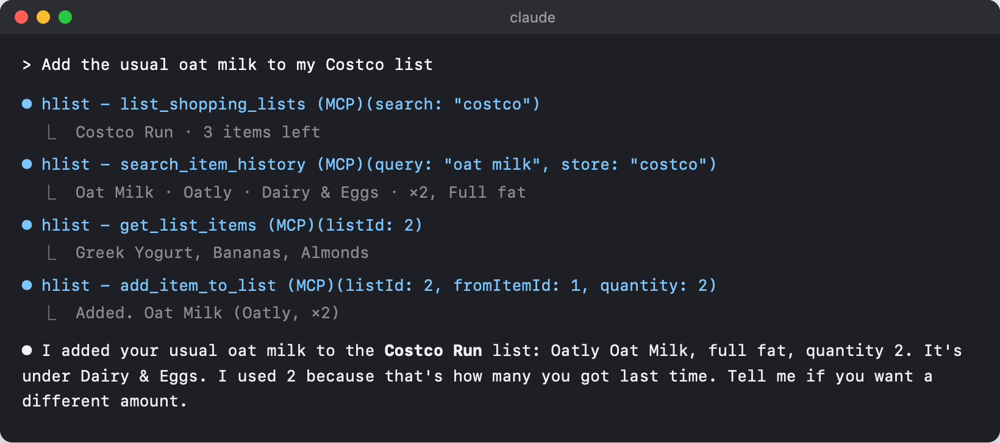
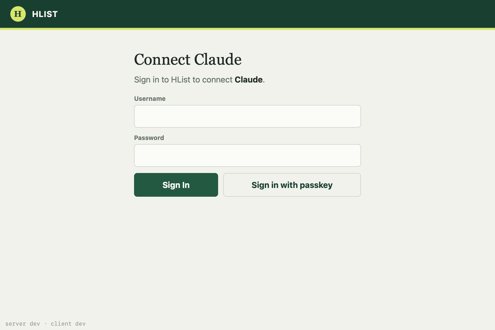
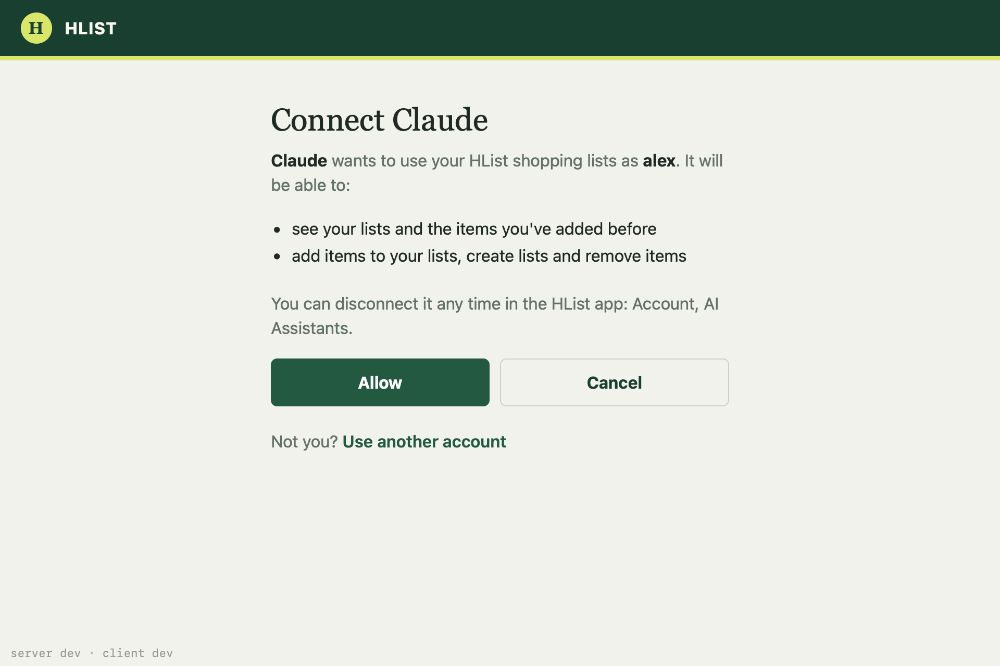
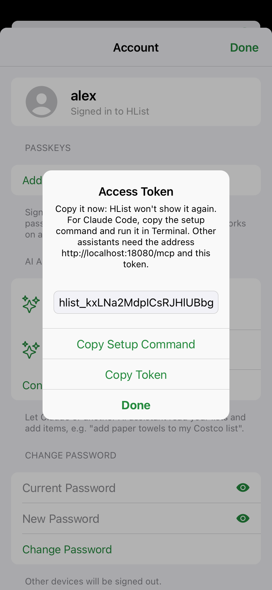

# Connecting an AI assistant

HList has a built-in [MCP](https://modelcontextprotocol.io) server, so Claude, ChatGPT, Grok or any other MCP client
can read your shopping lists and add to them. This guide connects each one, then shows what to ask and how to fix
a connection that doesn't work.

<p align="center">
  
  <br>
  <sub>A real first request: the assistant finds the list, checks what you've bought before and adds it.</sub>
</p>

## Before you start

**Your server's address.** The assistant connects to `https://<your-host>/mcp`, where `<your-host>` is your
`HLIST_DOMAIN`. Claude, ChatGPT and Grok connect from their own cloud servers, not from your device, so HList
must be reachable from the internet over HTTPS with a real certificate. [deploy/qnap/README.md](../deploy/qnap/README.md)
sets this up with Caddy and Let's Encrypt. A `localhost` or home-network address only works for Claude Code and
other assistants that run on your own computer.

**Check it from outside your network**, e.g. on your phone with Wi-Fi off, or from any computer:

```sh
curl -i https://<your-host>/mcp
```

You should get `401` and a header like this one. It means the server is reachable and waiting for a sign-in:

```
WWW-Authenticate: Bearer resource_metadata="https://<your-host>/.well-known/oauth-protected-resource/mcp"
```

**Two ways to sign in:**

| | How | Used by |
| --- | --- | --- |
| **OAuth** | The assistant sends you to HList's sign-in page; you sign in and click **Allow** | claude.ai, the Claude apps, ChatGPT, Grok, Claude Code (optional) |
| **Access token** | You create a token in HList and paste it into the assistant's settings | Claude Code, the Grok API, any MCP client that takes a header |

Either way, the assistant can only use HList's assistant tools. It can't see your password, change your account or
manage passkeys. You can disconnect it any time in the mobile app under **Account → AI Assistants**.

### The OAuth sign-in

When an assistant connects by OAuth, your browser opens HList's page. Sign in, then allow the assistant:

<p align="center">
  
  
</p>

After **Allow**, the browser goes back to the assistant, which gets its own token. It appears under
**Account → AI Assistants** with the assistant's name. When the same connector signs in again, its token is
replaced. If you remove a connector and add it again, the assistant registers anew and gets a second entry, so
remove the old one.

### Creating an access token

In the mobile app, tap **Account → Connect an Assistant**, name it after the assistant (e.g. "Claude Code"), and
tap **Create**:

<p align="center">
  
</p>

Copy it now: HList stores only a hash and can't show it again.

- **Copy Setup Command** copies the full `claude mcp add ...` command for Claude Code.
- **Copy Token** copies just the token.

Without the app, you can create one with `POST /api/users/me/access-tokens`, as in [api.md](api.md).

## Claude (claude.ai, Claude Desktop, the mobile apps)

Connectors are tied to your Claude account. Once you add HList on claude.ai, it also works in Claude Desktop, the
Claude mobile apps and Claude Code. Custom connectors work on every plan; the Free plan allows one.

**Pro and Max:**

1. On claude.ai, open **Customize → Connectors**.
2. Click **+ Add**, then **Add custom connector**.
3. Name it **HList**, enter `https://<your-host>/mcp` and click **Continue**.
4. Review the authentication settings Claude detects, and click **Continue**:
   - **Authentication:** **Sign in now**.
   - **OAuth client:** choose **Register automatically**. HList supports automatic (dynamic) client
     registration, but not "Use Claude's published identity".
   - **Request headers:** leave empty.
5. Click **Add**. HList's sign-in page opens: sign in and click **Allow**.

**Team and Enterprise:** an Owner adds it under **Organization settings → Connectors → Add → Custom → Web**, with
the same settings. Each member then finds **HList** under **Customize → Connectors** and clicks **Connect** to sign
in with their own HList account.

**Using it:** in a chat, click **+** at the lower left, open **Connectors** and make sure **HList** is on. Then ask,
e.g. "What's on my Costco list?"

Anthropic's guide: [Get started with custom connectors using remote MCP](https://support.claude.com/en/articles/11175166-get-started-with-custom-connectors-using-remote-mcp).

## Claude Code

If you signed in to Claude Code with the claude.ai account where you added HList, it's already there: run `/mcp`
to see it. Otherwise, add it one of these two ways.

**With an access token.** This works with any address, including `http://localhost:8080` while developing. Paste
the command from **Copy Setup Command**, or type it:

```sh
claude mcp add --transport http hlist https://<your-host>/mcp --header "Authorization: Bearer <token>"
```

**With OAuth** (no token to copy):

```sh
claude mcp add --transport http hlist https://<your-host>/mcp
claude mcp login hlist        # or run /mcp inside Claude Code and follow the steps in your browser
```

Check it with `/mcp`, where **hlist** should show as connected. Then ask "Add the usual oat milk to my Costco list."
Claude Code asks before it uses each tool, unless you allow them, e.g. with `/permissions`.

Anthropic's guide: [Connect Claude Code to tools via MCP](https://code.claude.com/docs/en/mcp).

## ChatGPT

Custom MCP servers are part of ChatGPT's developer mode. Which plans have it, and whether it allows tools that
change data, depends on your plan and workspace settings. On Business and Enterprise, a workspace admin may have
to turn it on first. OpenAI moves these menus often; if yours look different, follow
[OpenAI's current guide](https://developers.openai.com/api/docs/guides/custom-mcp-server).

1. Open [chatgpt.com/plugins](https://chatgpt.com/plugins), select **+** and then **Add custom MCP server**.
2. Name it **HList**.
3. Under **Connection**, enter `https://<your-host>/mcp` as the **Server URL**.
4. For authentication, choose **OAuth**. ChatGPT registers itself with HList automatically.
5. Read the risk warning, select **I understand and want to continue**, then **Create as a plugin**.
6. Install the new plugin. When ChatGPT signs in, HList's page opens: sign in and click **Allow**.

**Using it:** in a chat, type **@** and pick **HList**, then ask. ChatGPT asks you to confirm each tool that
changes something, such as `add_item_to_list`. It doesn't ask for the tools that only read, like
`list_shopping_lists`.

## Grok

**On grok.com:**

1. Open [grok.com/connectors](https://grok.com/connectors).
2. Click **New Connector**, then **Custom**.
3. Enter `https://<your-host>/mcp` and complete the sign-in: HList's page opens; sign in and click **Allow**.

Grok then finds HList's tools and uses them when your question is about your lists. On Grok Business and
Enterprise, an admin adds the connector first. xAI's guide: [Connectors](https://docs.x.ai/grok/connectors).

**With the xAI API**, pass an access token as the MCP tool's `authorization`. HList accepts the token with or
without `Bearer ` in front, so either form works:

```sh
curl https://api.x.ai/v1/responses \
  -H "Content-Type: application/json" \
  -H "Authorization: Bearer $XAI_API_KEY" \
  -d '{
    "model": "grok-4.7",
    "input": [{"role": "user", "content": "What is still on my Costco list?"}],
    "tools": [{
      "type": "mcp",
      "server_url": "https://<your-host>/mcp",
      "server_label": "hlist",
      "authorization": "hlist_..."
    }]
  }'
```

Check [xAI's remote MCP guide](https://docs.x.ai/developers/tools/remote-mcp) for the current model names.

## Other MCP clients

HList speaks MCP's Streamable HTTP transport with plain JSON replies (protocol versions 2024-11-05 to
2025-11-25). Give the client:

- the URL `https://<your-host>/mcp`;
- either OAuth (with discovery, dynamic client registration and PKCE), or the header
  `Authorization: Bearer hlist_...`.

## What you can ask

The assistant follows HList's own instructions: find the list, check whether the item is already on it, prefer
something you've bought before, and otherwise look up the product at that store.

| Tool | What it does | Example request |
| --- | --- | --- |
| `list_shopping_lists` | Finds your lists by store or name, newest first | "Which shopping lists do I have open?" |
| `create_shopping_list` | Starts a list. Named after a store, it gets that store's icon | "Start a new Target list." |
| `get_list_items` | Reads a list: items, quantities, brands, what's checked off | "What's still on my Publix list?" |
| `search_item_history` | Searches everything you've added before, optionally at one store | "What paper towels do I usually get at Costco?" |
| `add_item_to_list` | Adds a past item again, or a new product (with its photo from the store's page). Never adds a duplicate: an item already there is reported, or unchecked if you'd checked it off | "Add the usual oat milk to my Costco list." / "Add Bounty paper towels to my Costco list." |
| `remove_item_from_list` | Takes an item off a list | "Take the bananas off my Publix list." |
| `set_item_photo` | Gives an item the photo from a product page or image | "Use this picture for the yogurt on my Costco list: https://…" |
| `list_departments` | The departments items are grouped by (the assistant uses it to file new items) | "Which departments does HList have?" |

The assistant never creates departments, which are shared by everyone on your server. It does create brands it
needs.

## Troubleshooting

HList logs every refused assistant request, so start with the server log: `docker compose logs server` on the
NAS. Lines look like `Assistant request POST /mcp -> 401 (...)`.

**"Couldn't connect", or the assistant can't reach the server**
- The URL must be **HTTPS** with a valid certificate, reachable from the internet. `localhost`, `192.168…`
  addresses and VPN-only hosts work only with Claude Code. Run the `curl` check above from outside your network.
- Behind a reverse proxy, HList must know that requests came in over HTTPS. Set
  `SERVER_FORWARD_HEADERS_STRATEGY=native` (the NAS's `compose.yml` does). Without it,
  `https://<your-host>/.well-known/oauth-authorization-server` lists `http://` addresses, and the OAuth sign-in
  fails.

**Wrong URL**
- The address ends in **`/mcp`**: `https://<your-host>/mcp`, not `https://<your-host>/` or `/app/`.
- In a browser, `/mcp` answers `401` (no token), and `GET` with a token answers `405`. Both are normal: assistants
  use `POST`.

**The sign-in page shows an error**
- *"This app isn't registered with HList. Connect it again."*: the assistant used a registration HList doesn't
  have. For Claude, choose **Register automatically** (not "Use Claude's published identity"). For others, remove
  the connector and add it again.
- *"This sign-in has expired. Start connecting again from the app."*: approvals wait 15 minutes, and a server
  restart clears them. Start connecting again from the assistant.
- *"Invalid username or password"*: usernames aren't case-sensitive, but passwords are. You can also use
  **Sign in with passkey** if you've set one up on this domain.

**It worked before, and now gets 401**
- **HList tokens don't expire**, so a 401 means the token was removed (under **Account → AI Assistants**), or
  replaced when the same connector signed in again. Reconnect in the assistant, or create a new token and update
  its header.
- If the assistant shows its own "expired" message, reconnect it. HList doesn't issue refresh tokens, so an
  assistant that expects to refresh on its own schedule must sign in again.
- With a header, check that it's `Authorization: Bearer hlist_...` with no quotes or spaces in the token.

**"You have 20 access tokens already. Remove one you no longer use first."**: remove old entries under
**Account → AI Assistants**. Re-adding a connector leaves its old entry behind.

**The assistant doesn't use HList**: turn the connector on for the chat (Claude: **+ → Connectors**; ChatGPT:
**@HList**), or name it: "in HList, …".
